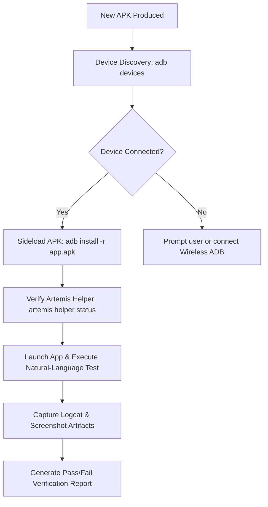

# Google ARTEMIS Skill: Autonomous Android APK Automation & Testing

This skill equips Antigravity with **Google ARTEMIS**, the open-source Android automation framework engineered by Google's Pixel-Test-Engineering (PTE) Fusion team. It enables AI-driven natural-language control of Android devices, automated APK testing, UI hierarchy inspection, and Model Context Protocol (MCP) integration.

---

## 1. When to Use This Skill (Trigger Conditions)

Activate this skill immediately whenever a user request or agent workflow involves:
1. **APK Packaging & Verification**:
   - Building or testing `.apk` files generated by `web-to-apk-agent` or `apk-tv-converter-agent`.
   - Validating newly compiled APKs before production deployment.
2. **Device & Emulator Interaction**:
   - Connecting to physical Android phones, tablets, or Android TV / Fire TV over ADB (wired USB or wireless IP).
   - Sideloading, installing, or launching an APK on a connected device.
3. **Artemis Accessibility Helper APK**:
   - Managing Google's lightweight Accessibility Helper APK (`artemis helper install`, `status`, `uninstall`).
   - Reading real-time screen view hierarchies without conflicting with standard UIAutomator sessions.
4. **Natural-Language QA & End-to-End Journeys**:
   - Automating user flows on an Android app: "Log in with test credentials, verify the home screen opens, and take a screenshot".
   - Smoke-testing APK launch time, crash detection via Logcat, and UI responsiveness.
5. **Model Context Protocol (MCP)**:
   - Setting up or using the Artemis MCP server (`uv run artemis mcp --install antigravity`) to provide direct screen inspection and tap/type tools to Antigravity.

---

## 2. Google ARTEMIS Architecture & Execution Profiles

Google ARTEMIS operates with two primary performance execution profiles:

| Profile | Latency / Step | Execution Style | Best For |
| :--- | :--- | :--- | :--- |
| **`flash`** | **3 – 5 seconds** | Fast, reactive single-model perception loop. | Direct interactions: clicking buttons, entering text, scrolling lists, capturing screenshots. |
| **`pro`** | **10 – 20 seconds** | Deep reasoning, multi-step planning, and visual verification. | Complex multi-screen journeys, checkout flows, login validation, and error recovery. |

Command invocation pattern:
```bash
uv run artemis run "<Natural language instruction>" --profile flash
uv run artemis run "<Complex multi-screen journey>" --profile pro
```

---

## 3. Artemis Accessibility Helper APK Lifecycle

To inspect screen layouts with extreme speed and reliability without breaking native ADB debugging tools, Google ARTEMIS uses an on-device **Accessibility Helper APK**.

### Commands:
1. **Install Helper APK on target device**:
   ```bash
   uv run artemis helper install
   ```
2. **Check Helper APK status**:
   ```bash
   uv run artemis helper status
   ```
3. **Uninstall Helper APK**:
   ```bash
   uv run artemis helper uninstall
   ```

> [!TIP]
> The helper APK operates locally on the target device via Android's Accessibility APIs to dump layout hierarchies in milliseconds.

---

## 4. Model Context Protocol (MCP) Integration for Antigravity

Google ARTEMIS provides an official MCP server for AI coding assistants.

### Quick Setup:
```bash
# Install Artemis MCP tools into Antigravity
uv run artemis mcp --install antigravity

# Or install for all IDE environments
uv run artemis mcp --install all
```

Once installed, Antigravity has direct access to device tools:
- `artemis_click(x, y)`: Tap specific screen coordinates or UI element ID.
- `artemis_type(text)`: Input text into the focused field.
- `artemis_screenshot()`: Capture active screen frame.
- `artemis_hierarchy()`: Dump current XML/JSON view hierarchy.
- `artemis_key(keycode)`: Send hardware keys (Home, Back, Enter, D-pad).

---

## 5. End-to-End Autonomous APK Testing Workflow

When an APK is built or provided, follow this standard runbook:



### Step 1: Detect Connected Android Devices
```bash
adb devices -l
# Or via Artemis APK bridge:
artemis-apk devices
```

### Step 2: Install Target APK
```bash
adb install -r -d /path/to/app.apk
# Or via Artemis APK bridge:
artemis-apk install /path/to/app.apk
```

### Step 3: Run Automated Test Journey
```bash
uv run artemis run "Open Chamunda Automobile app, tap on New Booking, verify form loads, and take a screenshot" --profile flash
```

### Step 4: Verify Android TV / Fire TV Compatibility
For TV apps generated by `apk-tv-converter-agent`:
- Verify leanback banner: `com.google.android.tv.launcher`
- Verify D-pad DPAD_CENTER / DPAD_DOWN navigation without touch screen requirement.

---

## 6. Companion CLI: `artemis-apk`

This environment provides a pre-configured global command:

```bash
# List devices
artemis-apk devices

# Install APK
artemis-apk install /path/to/app.apk

# Smoke test APK with automated screenshot
artemis-apk test /path/to/app.apk --task "Launch app and verify home screen"

# Manage Artemis Helper APK
artemis-apk helper status
artemis-apk helper install
```
